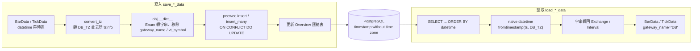
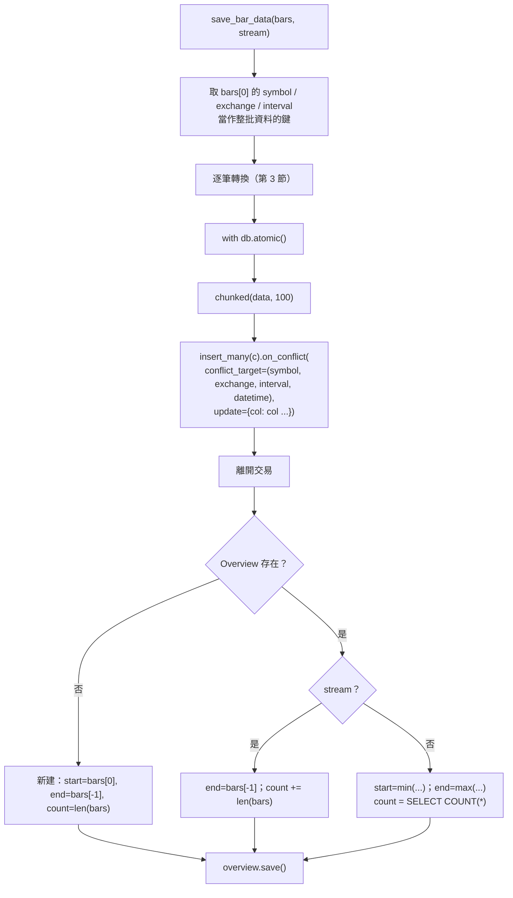
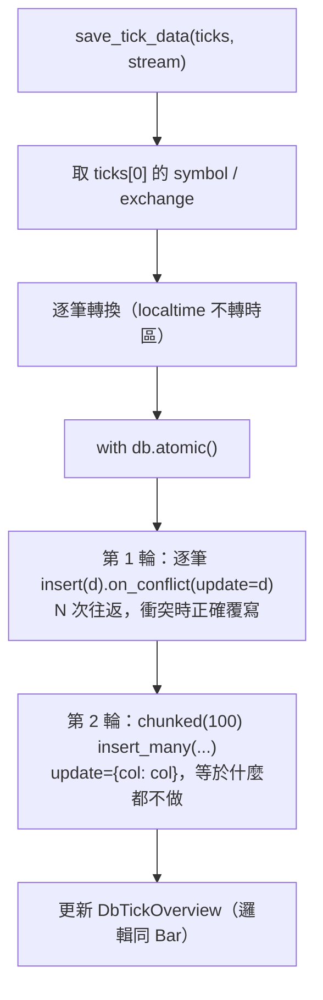

# vnpy_postgresql 資料庫轉換方法與寫入方法分析

> 範圍：`vnpy_postgresql/postgresql_database.py`（v1.0.3）與核心 `vnpy/trader/database.py` 中的 `DB_TZ`、`convert_tz()`。
> 相關文件：[ANALYSIS.md](./ANALYSIS.md)、[FLOWCHART.md](./FLOWCHART.md)
> 文中標「已驗證」的結論，都在 peewee 4.5.3 與 Python 3 下實際執行過（SQL 產生與時區換算），驗證程式碼附在第 7 節。

---

## 1. 總覽



| 方向 | 方法 | 轉換內容 |
|---|---|---|
| 物件 → 資料庫 | `save_bar_data`、`save_tick_data` | 時區、Enum → 字串、刪除非欄位屬性 |
| 資料庫 → 物件 | `load_bar_data`、`load_tick_data` | naive 時間 → 帶 `DB_TZ` 的時間、字串 → Enum |
| 匯總 | `get_bar_overview`、`get_tick_overview`、`init_bar_overview` | 字串 → Enum；舊資料重建 overview |

---

## 2. 時間轉換

### 2.1 寫入：`convert_tz()`（核心 `vnpy/trader/database.py`）

```python
DB_TZ = ZoneInfo(SETTINGS["database.timezone"])   # 預設為系統時區 get_localzone_name()

def convert_tz(dt: datetime) -> datetime:
    dt = dt.astimezone(DB_TZ)       # 轉到資料庫時區
    return dt.replace(tzinfo=None)  # 去掉時區資訊
```

- PostgreSQL 欄位由 peewee `DateTimeField` 建立，型別為 **`timestamp without time zone`**，所以寫入前先換成「DB_TZ 下的掛鐘時間」並去掉 tzinfo。
- 只轉換 `datetime` 欄位。**`TickData.localtime` 沒有轉換**，會以原樣（可能帶時區，也可能不帶）交給 psycopg2。
- 若傳入的是 **naive datetime**，`astimezone()` 會把它當成**系統本地時間**再轉換（已驗證：系統為 UTC 時，naive `09:30` 會被存成 `17:30`）。

### 2.2 讀取：`fromtimestamp(..., DB_TZ)`

```python
datetime=datetime.fromtimestamp(db_bar.datetime.timestamp(), DB_TZ)
```

- 資料庫讀出的是 naive datetime。`naive.timestamp()` 會把它當成**系統本地時間**換算成 epoch，再用 `DB_TZ` 還原。
- 因此只有在 **系統時區 == `database.timezone`** 時，寫入與讀出才會一致。

### 2.3 時區不一致時資料會偏移（已驗證）

`database.timezone = "Asia/Shanghai"`，寫入 `2024-01-02 09:30+08:00`：

| 系統時區（TZ） | 存入資料庫 | 讀出結果 | 是否一致 |
|---|---|---|---|
| Asia/Shanghai | `2024-01-02 09:30:00` | `2024-01-02 09:30:00+08:00` | ✅ |
| UTC | `2024-01-02 09:30:00` | `2024-01-02 17:30:00+08:00` | ❌ 偏移 8 小時 |

常見觸發情境：Linux 伺服器或 Docker 容器的系統時區是 UTC，而 `vt_setting.json` 設了 `"database.timezone": "Asia/Shanghai"`。

**建議寫法**（跟系統時區無關）：
```python
datetime=db_bar.datetime.replace(tzinfo=DB_TZ)
```

### 2.4 查詢條件沒有做時區轉換

`load_bar_data / load_tick_data` 直接把呼叫端傳入的 `start / end` 放進 `WHERE datetime >= start AND datetime <= end`，沒有先 `convert_tz()`。呼叫端（ChartWizard、DataManager）通常傳入帶時區的 datetime，psycopg2 會以 `timestamptz` 參數送出，再由 PostgreSQL 依 **連線 session 的 `TimeZone`** 轉成 `timestamp` 比較。如果伺服器的 `TimeZone` 和 `DB_TZ` 不同，查詢區間會偏移。建議查詢前一律 `start = convert_tz(start)`、`end = convert_tz(end)`。

---

## 3. 物件 ↔ 資料表欄位轉換

### 3.1 BarData → DbBarData

| BarData 屬性 | 轉換 | DbBarData 欄位 |
|---|---|---|
| `symbol` | 原樣 | `symbol` CharField |
| `exchange: Exchange` | `.value`，例如 `"SHFE"` | `exchange` CharField |
| `datetime` | `convert_tz()` | `datetime` DateTimeField |
| `interval: Interval` | `.value`：`"1m" / "1h" / "d" / "w"` | `interval` CharField |
| `volume / turnover / open_interest / open_price / high_price / low_price / close_price` | 原樣 | FloatField |
| `gateway_name` | **pop 刪除** | — |
| `vt_symbol`（`__post_init__` 產生） | **pop 刪除** | — |
| — | 自動 | `id` AutoField |

唯一索引：`(symbol, exchange, interval, datetime)`。

### 3.2 TickData → DbTickData

| TickData 屬性 | 轉換 | DbTickData 欄位 |
|---|---|---|
| `symbol / name` | 原樣 | CharField |
| `exchange` | `.value` | CharField |
| `datetime` | `convert_tz()` | DateTimeField |
| 成交與統計：`volume, turnover, open_interest, last_price, last_volume, limit_up, limit_down, open_price, high_price, low_price, pre_close` | 原樣 | FloatField（NOT NULL） |
| 一檔：`bid/ask_price_1`、`bid/ask_volume_1` | 原樣 | FloatField（NOT NULL） |
| 二到五檔：`bid/ask_price_2~5`、`bid/ask_volume_2~5` | 原樣 | FloatField（`null=True`） |
| `localtime` | **未轉換** | DateTimeField（`null=True`） |
| `gateway_name`、`vt_symbol` | **pop 刪除** | — |

唯一索引：`(symbol, exchange, datetime)`。

### 3.3 讀取方向

`load_*_data` 逐列建立新物件：`Exchange(db.exchange)`、`Interval(db.interval)`、時間依 2.2 還原、`gateway_name="DB"`。`vt_symbol` 由 dataclass 的 `__post_init__` 重新產生。

### 3.4 轉換方式的副作用：呼叫端物件被修改（已驗證）

```python
for bar in bars:
    bar.datetime = convert_tz(bar.datetime)   # 直接改原物件
    d: dict = bar.__dict__                    # 拿到的是物件本身的屬性字典，不是副本
    d["exchange"] = d["exchange"].value       # 物件的 exchange 變成字串
    d["interval"] = d["interval"].value       # 物件的 interval 變成字串
    d.pop("gateway_name")                     # 物件失去 gateway_name
    d.pop("vt_symbol")                        # 物件失去 vt_symbol
```

呼叫 `save_bar_data(bars)` 之後，`bars` 裡的每個物件：
- `bar.vt_symbol`、`bar.gateway_name` → `AttributeError`
- `bar.exchange.value` → `AttributeError: 'str' object has no attribute 'value'`
- `bar.datetime` 變成 naive 時間

而且**同一批資料不能再存一次**：第二次執行 `d["exchange"].value` 時，`exchange` 已經是字串，會直接報錯。

目前的呼叫端（DataRecorder、DataManager 下載）存完就不再使用這些物件，所以還沒出問題；但只要有模組先存檔再繼續使用 bar（例如邊下載邊畫圖、存檔後再推送事件），就會出錯。

**建議**：`d = copy(bar.__dict__)`，或用 `dataclasses.asdict(bar)` 再刪除欄位。

---

## 4. 寫入方法

### 4.1 `save_bar_data(bars, stream=False)` 流程



### 4.2 Upsert 衝突時不更新（已驗證）

程式碼：
```python
DbBarData.insert_many(c).on_conflict(
    update={DbBarData.volume: DbBarData.volume, DbBarData.close_price: DbBarData.close_price, ...},
    conflict_target=(DbBarData.symbol, DbBarData.exchange, DbBarData.interval, DbBarData.datetime),
)
```

peewee 產生的 SQL：
```sql
INSERT INTO "dbbardata" (...) VALUES (...)
ON CONFLICT ("symbol", "exchange", "interval", "datetime")
DO UPDATE SET "volume" = "dbbardata"."volume", ...
```

`"dbbardata"."volume"` 指的是**資料表裡原本的值**，所以遇到重複時間點時，整列等於「用舊值覆蓋舊值」。實際效果：

| 情境 | 預期 | 實際 |
|---|---|---|
| 新時間點 | 新增 | ✅ 新增 |
| 已存在時間點，資料修正後重新下載 | 覆寫成新值 | ❌ 保留舊值 |
| DataRecorder 盤中重啟，同一分鐘 bar 再寫一次 | 用較完整的 bar 覆寫 | ❌ 保留先寫入的不完整 bar |

要引用「這次要插入的值」，應使用 PostgreSQL 的 `EXCLUDED`。peewee 可以用 `preserve` 寫：

```python
.on_conflict(
    conflict_target=(DbBarData.symbol, DbBarData.exchange, DbBarData.interval, DbBarData.datetime),
    preserve=[DbBarData.volume, DbBarData.turnover, DbBarData.open_interest,
              DbBarData.open_price, DbBarData.high_price, DbBarData.low_price, DbBarData.close_price],
)
# 產生：DO UPDATE SET "volume" = EXCLUDED."volume", ...
```

### 4.3 `save_tick_data(ticks, stream=False)` 流程



- **第 1 輪**：`update=d` 會產生 `SET "symbol" = %s, "volume" = %s, ...`，用新值覆寫，結果正確。但它是逐筆送出，N 筆 tick 就要和資料庫往返 N 次。另外它也把衝突鍵（symbol、exchange、datetime）一起 SET，雖然沒有害處，但沒必要。
- **第 2 輪**：同一批資料再批次寫一次。因為第 1 輪已經寫入，這次每一列都會衝突，然後依 4.2 的問題「用舊值覆蓋舊值」，**什麼都沒改，只是浪費一次寫入**。
- 結果：Tick 的寫入結果是對的，但成本大約是必要的 2 倍以上，而且主要花在逐筆往返上。DataRecorder 每 10 秒寫一批 Tick，訂閱合約一多就會成為瓶頸。

**建議**：刪掉第 1 輪逐筆迴圈，只保留 `insert_many` 並改用 `preserve=`（同 4.2）。

### 4.4 交易與一致性

| 項目 | 現況 | 風險 |
|---|---|---|
| 資料寫入 | 在 `db.atomic()` 內，整批要嘛全部成功，要嘛全部回滾 | ✅ |
| Overview 更新 | 在 `atomic()` **外面** | 資料寫入成功但 overview 更新失敗時，兩者不一致 |
| 連線 | `autorollback=True`；模組層級共用單一連線 | DataRecorder 的寫入執行緒與 UI 執行緒的 DataManager 共用同一個 `db` 物件；peewee 預設每個執行緒各自管理連線狀態，但重連後是否正常，要視 peewee 設定而定 |

### 4.5 Overview（匯總表）計算方式

| 模式 | start | end | count | 問題 |
|---|---|---|---|---|
| 首次寫入 | `bars[0].datetime` | `bars[-1].datetime` | `len(bars)` | 假設輸入已按時間排序 |
| `stream=True`（DataRecorder） | 不變 | `bars[-1].datetime` | `+= len(bars)` | 重複資料也會被計數，count 偏大；end 可能倒退 |
| `stream=False`（DataManager） | `min(bars[0], 原 start)` | `max(bars[-1], 原 end)` | `SELECT COUNT(*)` | 準確，但大表每次 COUNT 很慢 |

### 4.6 輸入前提（沒有檢查）

1. **非空**：`bars[0]` 在空 list 時會 `IndexError`（目前呼叫端都有先判斷 `if data`）。
2. **同一合約、同一週期**：鍵只取第一筆，混合不同合約的批次時，overview 會整批算到第一個合約上。DataRecorder 依 `vt_symbol` 分批，所以目前沒問題。
3. **已排序**：overview 的 start/end 直接取首尾。
4. **`interval` 不為 None**：`BarData.interval` 預設是 `None`，沒設定時 `.value` 會報錯。

---

## 5. 讀取 / 刪除 / 匯總方法摘要

| 方法 | 行為 | 備註 |
|---|---|---|
| `load_bar_data(symbol, exchange, interval, start, end)` | WHERE 條件 + `ORDER BY datetime`，逐列建立 `BarData` | 一次全部載入記憶體；時間問題見 2.2、2.4 |
| `load_tick_data(...)` | 同上 | `localtime` 原樣讀回 |
| `delete_bar_data(symbol, exchange, interval)` | 刪除資料，再刪除 overview | 兩個 DELETE 不在同一個交易內；不能指定時間區間 |
| `delete_tick_data(symbol, exchange)` | 同上 | |
| `get_bar_overview()` | 有 K 線但沒有 overview 時先 `init_bar_overview()` | 會把 peewee Model 的 `exchange / interval` 欄位改成 Enum 後回傳 |
| `init_bar_overview()` | GROUP BY 計數，每組再查兩次首尾時間 | 組數多時查詢次數為 1 + 2N |
| `get_tick_overview()` | 只讀取，**沒有** init 邏輯 | 與 bar 不對稱 |

---

## 6. 問題彙整與修正建議

| # | 嚴重度 | 問題 | 位置 | 建議修正 |
|---|---|---|---|---|
| 1 | 高 | Bar 的 upsert 衝突時不更新（`SET col = 舊值`） | `save_bar_data` | 改用 `preserve=[...]`，產生 `EXCLUDED` |
| 2 | 高 | 系統時區 ≠ `database.timezone` 時，讀出時間偏移 | `load_*_data` | `db.datetime.replace(tzinfo=DB_TZ)` |
| 3 | 高 | 修改呼叫端物件（屬性被刪、Enum 變字串）；同一批無法重複存 | `save_*_data` | `d = copy(obj.__dict__)` |
| 4 | 中 | Tick 逐筆 + 批次重複寫入 | `save_tick_data` | 只保留批次 `insert_many` + `preserve` |
| 5 | 中 | 查詢的 `start/end` 沒有轉 DB_TZ | `load_*_data` | 查詢前先 `convert_tz()` |
| 6 | 中 | stream 模式 count 偏大、end 可能倒退 | overview 更新 | `end = max(...)`；定期用 COUNT 校正 |
| 7 | 低 | Overview 更新在交易外 | `save_*_data` | 移進 `with db.atomic()` |
| 8 | 低 | `localtime` 沒有轉時區 | `save_tick_data` | 和 `datetime` 一起 `convert_tz()`（不為 None 時） |
| 9 | 低 | 沒有檢查空 list、混合合約、未排序、interval 為 None | `save_*_data` | 開頭加檢查，必要時先排序 |

### 修正後的 `save_bar_data` 寫法（參考）

```python
from copy import copy

def save_bar_data(self, bars: list[BarData], stream: bool = False) -> bool:
    if not bars:
        return False
    bars = sorted(bars, key=lambda b: b.datetime)
    bar = bars[0]
    symbol, exchange, interval = bar.symbol, bar.exchange, bar.interval

    data: list = []
    for bar in bars:
        d = copy(bar.__dict__)                 # 不修改呼叫端物件
        d["datetime"] = convert_tz(bar.datetime)
        d["exchange"] = bar.exchange.value
        d["interval"] = bar.interval.value
        d.pop("gateway_name", None)
        d.pop("vt_symbol", None)
        d.pop("extra", None)
        data.append(d)

    fields = [DbBarData.volume, DbBarData.turnover, DbBarData.open_interest,
              DbBarData.open_price, DbBarData.high_price, DbBarData.low_price, DbBarData.close_price]

    with self.db.atomic():
        for c in chunked(data, 100):
            DbBarData.insert_many(c).on_conflict(
                conflict_target=(DbBarData.symbol, DbBarData.exchange,
                                 DbBarData.interval, DbBarData.datetime),
                preserve=fields,               # SET col = EXCLUDED.col
            ).execute()
        # ……overview 更新也放在交易內，end 用 max()……
    return True
```

---

## 7. 驗證方式

**Upsert SQL**（peewee 4.5.3，只產生 SQL，不需要連到 PostgreSQL）：
```python
from peewee import *
db = PostgresqlDatabase("x")
class T(Model):
    a = CharField(); v = FloatField()
    class Meta: database = db
print(T.insert_many([{"a": "x", "v": 1}]).on_conflict(update={T.v: T.v}, conflict_target=(T.a,)).sql())
# → ... ON CONFLICT ("a") DO UPDATE SET "v" = "t"."v"     ← 原本的值
print(T.insert_many([{"a": "x", "v": 1}]).on_conflict(preserve=[T.v], conflict_target=(T.a,)).sql())
# → ... ON CONFLICT ("a") DO UPDATE SET "v" = EXCLUDED."v" ← 這次插入的值
```

**時區往返**（分別用 `TZ=Asia/Shanghai` 和 `TZ=UTC` 執行）：
```python
from datetime import datetime
from zoneinfo import ZoneInfo
DB_TZ = ZoneInfo("Asia/Shanghai")
orig = datetime(2024, 1, 2, 9, 30, tzinfo=DB_TZ)
stored = orig.astimezone(DB_TZ).replace(tzinfo=None)
loaded = datetime.fromtimestamp(stored.timestamp(), DB_TZ)
print(orig == loaded)   # Asia/Shanghai: True；UTC: False（17:30+08:00）
```

**`__dict__` 副作用**：對 dataclass 物件執行 `d = obj.__dict__; d.pop("gateway_name")` 之後，`hasattr(obj, "gateway_name")` 為 `False`。
